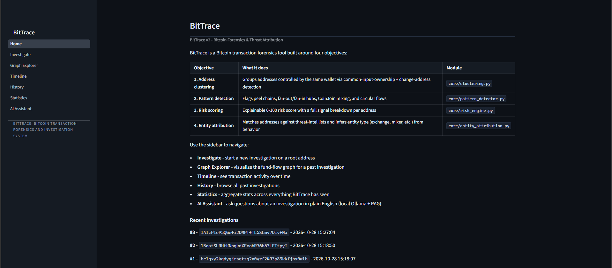
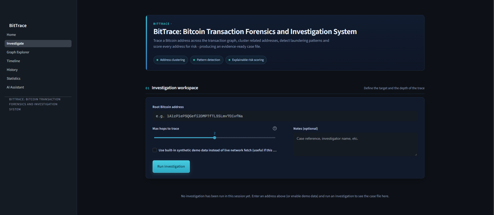
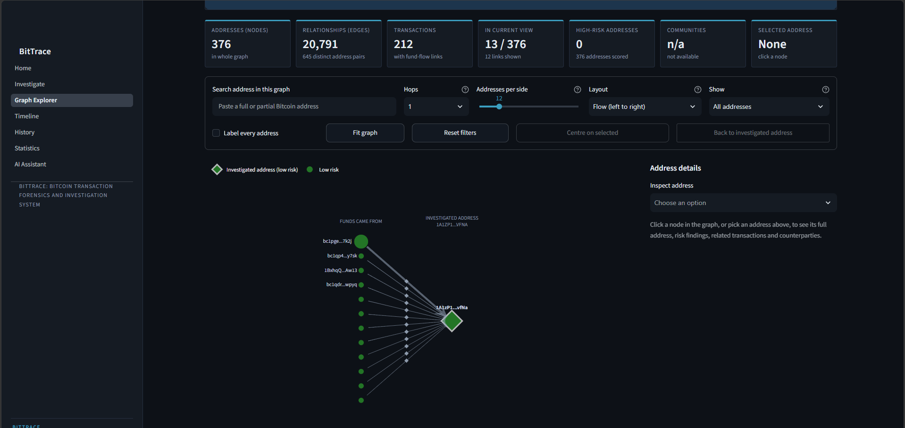
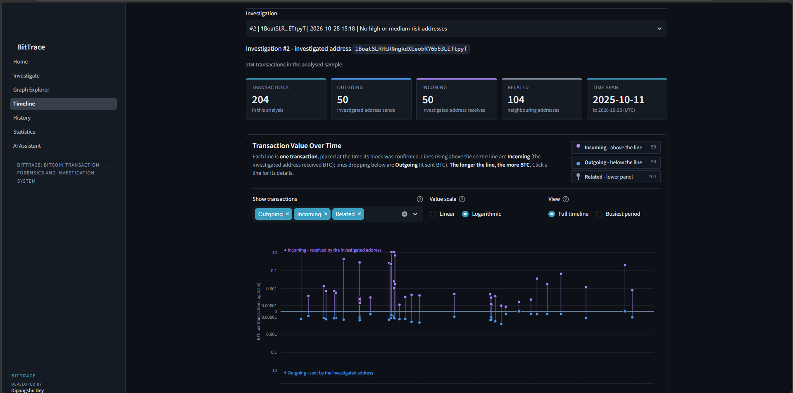
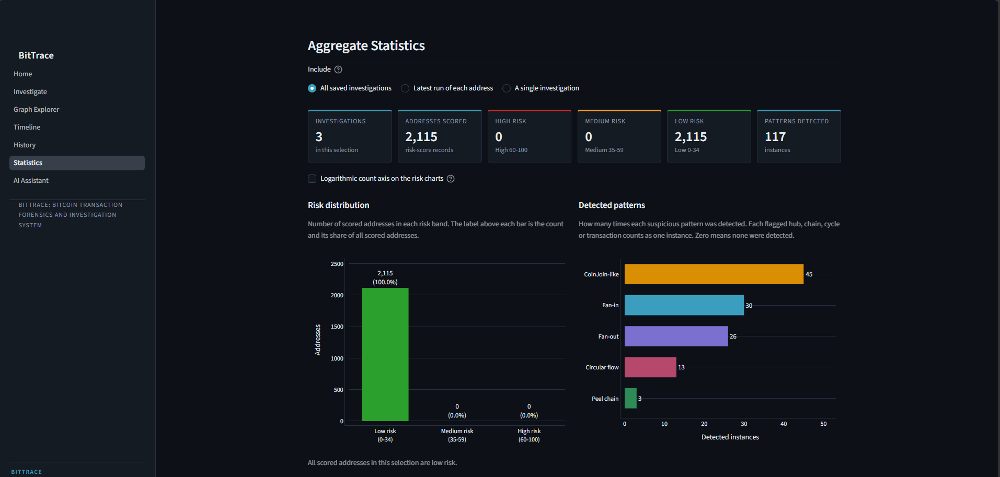
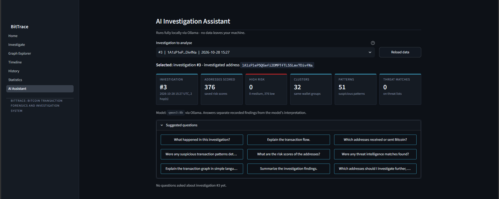

# BitTrace: Bitcoin Transaction Forensics and Investigation System

BitTrace is a Python-based Bitcoin transaction forensics and investigation system designed to analyse Bitcoin addresses, explore transaction relationships, detect potentially suspicious transaction patterns, and present investigation findings through an interactive dashboard.

## Overview

BitTrace brings multiple blockchain investigation features together in one application. Users can initiate investigations, explore transaction graphs, review transaction activity over time, examine statistical summaries, and ask investigation-related questions through an AI assistant.

The project demonstrates how blockchain data analysis, transaction visualisation, and analytical techniques can support Bitcoin investigations.

## Objectives

The main objectives of BitTrace are to:

- Investigate Bitcoin addresses and analyse related transaction activity.
- Visualise relationships between Bitcoin addresses and transactions.
- Identify transaction patterns that may require further investigation.
- Group potentially related Bitcoin addresses using analytical methods.
- Calculate and display address risk scores with supporting findings.
- Present transaction activity through graphs, timelines, and statistical summaries.
- Maintain a history of investigations where supported by the application.
- Generate PDF reports containing investigation findings.
- Provide an AI assistant to help interpret investigation results.

## Features

### 1. Bitcoin Investigation

The Investigation module allows users to enter a Bitcoin address and initiate an investigation.

Users can configure the maximum number of transaction hops to analyse and add optional investigation notes. The application processes available data and presents the resulting findings.

### 2. Transaction Graph Explorer

The Graph Explorer provides a visual representation of relationships between Bitcoin addresses and transaction flows.

It helps users explore connections within the investigated transaction graph, search for addresses, and inspect available address details.

### 3. Address Clustering

Address clustering analyses transaction relationships to identify groups of addresses that may be associated with the same wallet or entity.

Clustering results are analytical estimates and do not independently prove common ownership.

### 4. Transaction Pattern Detection

BitTrace supports the analysis of transaction patterns that may be relevant during blockchain investigations, including:

- Fan-in patterns
- Fan-out patterns
- Peel chains
- CoinJoin-like transaction patterns
- Circular transaction flows

These patterns can help investigators identify transaction structures that deserve closer examination. A detected pattern alone does not establish illegal activity.

### 5. Transaction Timeline

The Timeline module presents available transaction activity over time.

It provides a view of incoming, outgoing, and related transactions, helping users understand the sequence and distribution of transaction activity.

### 6. Investigation History

The History module allows users to review previously recorded investigations supported by the application.

This helps users revisit earlier investigation results.

### 7. Statistics Dashboard

The Statistics module presents aggregated information from available investigations.

Depending on the available data, it can display investigation counts, scored addresses, risk distributions, and detected transaction patterns.

### 8. AI Investigation Assistant

The AI Assistant provides an interface for asking questions about an investigation in natural language.

The application integrates with Ollama for local language-model processing. The assistant can help explain transaction flows, summarise findings, and answer questions using available investigation information.

AI-generated interpretations should be checked against the recorded investigation data.

### 9. Forensic Report Generation

BitTrace includes PDF report-generation functionality for presenting available investigation information in a structured format.

The reports can help organise investigation findings for documentation and review.

## Project Report

The complete project report provides further details about BitTrace, including its objectives, methodology, system design, implementation, and features.

[View the BitTrace Project Report (PDF)](docs/BitTrace_Project_Report.pdf)

Ensure that your PDF is stored at `docs/BitTrace_Project_Report.pdf`. If the filename or location differs, update the link accordingly.

## Technology Stack

| Technology | Purpose |
|---|---|
| Python | Main programming language |
| Streamlit | Web-based application interface |
| SQLite | Local database storage |
| Ollama | Local AI model integration |
| Graph visualisation libraries | Visual representation of transaction relationships |
| ReportLab | PDF report generation |
| Python blockchain data-processing libraries | Retrieving and analysing available transaction information |

The exact libraries and versions are specified in the project's `requirements.txt` and source code.

## Screenshots

The following screenshots show the main modules of the BitTrace application.

<table>
  <tr>
    <th>Home Page</th>
    <th>Investigation Workspace</th>
  </tr>
  <tr>
    <td></td>
    <td></td>
  </tr>
  <tr>
    <th>Graph Explorer</th>
    <th>Transaction Timeline</th>
  </tr>
  <tr>
    <td></td>
    <td></td>
  </tr>
  <tr>
    <th>Statistics Dashboard</th>
    <th>AI Investigation Assistant</th>
  </tr>
  <tr>
    <td></td>
    <td></td>
  </tr>
</table>

## Project Structure

The following structure represents the main directories and files of the project. Some internal files are omitted for readability.

```text
bittrace/
├── .streamlit/
├── ai/
│   ├── assistant.py
│   ├── investigation_context.py
│   ├── ollama_client.py
│   └── rag_engine.py
├── app/
│   ├── Home.py
│   └── pages/
│       ├── 1_Investigate.py
│       ├── 2_Graph_Explorer.py
│       ├── 3_Timeline.py
│       ├── 4_History.py
│       ├── 5_Statistics.py
│       └── 6_AI_Assistant.py
├── assets/
│   └── bittrace.png
├── core/
│   ├── clustering.py
│   ├── data_fetcher.py
│   ├── graph_analytics.py
│   ├── graph_builder.py
│   ├── pattern_detector.py
│   ├── pipeline.py
│   ├── report_generator.py
│   ├── risk_engine.py
│   └── threat_intel.py
├── data/
│   └── threat_intel/
├── db/
│   ├── database.py
│   └── schema.sql
├── docs/
│   ├── BitTrace_Project_Report.pdf
│   └── screenshots/
├── reports/
├── tests/
├── config.py
├── requirements.txt
├── ui_theme.py
├── run_bittrace.bat
└── run_bittrace_lan.bat
```

The project also includes launcher scripts, configuration files, and additional modules that support its functionality.

## System Requirements

The general requirements for running BitTrace are:

- Windows or another operating system supported by the project's dependencies.
- A compatible Python version.
- The required Python packages.
- Internet access when live blockchain data retrieval requires it.
- Ollama and a compatible model if the AI Assistant is enabled.

Check the project's dependencies and configuration for the exact Python version and setup requirements.

## Installation and Setup

### 1. Clone the Repository

Open a terminal and run:

```bash
git clone https://github.com/dipangshu-dey/-BitTrace.git
cd -BitTrace/bittrace
```

The repository contains the project in the `bittrace` directory. If the repository name or folder structure has changed, use the current repository URL and actual project directory.

### 2. Create a Virtual Environment

A virtual environment keeps the project's Python packages separate from other Python installations.

For Windows PowerShell, run:

```powershell
py -3.10 -m venv venv
```

Use the Python version required by the project's dependencies if it differs from Python 3.10.

### 3. Install Dependencies

Install the project's required packages:

```powershell
.\venv\Scripts\python.exe -m pip install -r requirements.txt
```

If installation fails, check your internet connection, Python version, and package compatibility.

### 4. Start the Application

Run the following command from the project directory:

```powershell
.\venv\Scripts\python.exe -m streamlit run app\Home.py
```

### 5. Open BitTrace

After starting the application, Streamlit displays a local address in the terminal. Open that address in your browser to access BitTrace.

Additional configuration may be required for live blockchain data retrieval and AI functionality.

## How to Use BitTrace

1. Start the BitTrace application.
2. Open the Investigate page from the sidebar.
3. Enter a Bitcoin address.
4. Select the investigation depth and provide optional notes.
5. Run the investigation.
6. Review the available investigation findings.
7. Open Graph Explorer to examine address relationships.
8. Open Timeline to review transaction activity over time.
9. Use History to revisit previously recorded investigations.
10. Review the Statistics dashboard for aggregate results.
11. Open AI Assistant to ask questions about an investigation, if the local AI service is available.
12. Generate a PDF report when the report-generation functionality is available.

The information displayed depends on the selected address, the data retrieved, and the application's configuration.

## Testing

The project includes tests for several components, including:

- Bitcoin address validation
- Blockchain data retrieval and error handling
- Transaction processing
- Address clustering
- Transaction pattern detection
- Risk-score calculation
- Graph generation
- Investigation history
- PDF report generation
- AI Assistant integration

Only tests that have actually been executed should be reported as passed. The presence of a test file does not, by itself, confirm that the application has passed the tests.

## Limitations

BitTrace has several limitations that should be considered when interpreting investigation results:

- Address clustering may identify potential relationships but cannot independently confirm wallet ownership.
- Transaction patterns may have legitimate explanations and should not automatically be considered evidence of criminal activity.
- Live blockchain data retrieval may depend on external services and network availability.
- Risk scores depend on the application's analytical rules and available information.
- AI-generated explanations may be inaccurate and should be verified against the underlying data.
- Identifying the real-world person or organisation controlling a Bitcoin address requires additional evidence.
- The completeness of an investigation depends on the data sources and analysis available to the application.

## Future Scope

Potential areas for future development include:

- Integration with additional blockchain data sources.
- Improvements to transaction graph exploration.
- Enhanced transaction pattern analysis.
- Additional investigation and reporting options.
- Improved error handling and automated testing.
- Expanded threat-intelligence integration.
- Further improvements to AI-assisted investigation workflows.

These are possible future enhancements and should not be interpreted as features that are already implemented.

## Developer

**Dipangshu Dey**

MSc Cyber Security  
National Forensic Sciences University (NFSU)

- GitHub: https://github.com/dipangshu-dey
- LinkedIn: https://www.linkedin.com/in/dipangshu-dey-251a80264/

## Disclaimer

BitTrace is an educational blockchain analysis and cybersecurity project intended to support the examination and visualisation of Bitcoin transaction activity.

Investigation results are analytical outputs and should not be treated as conclusive proof of criminal activity or definitive identification of a Bitcoin address owner.